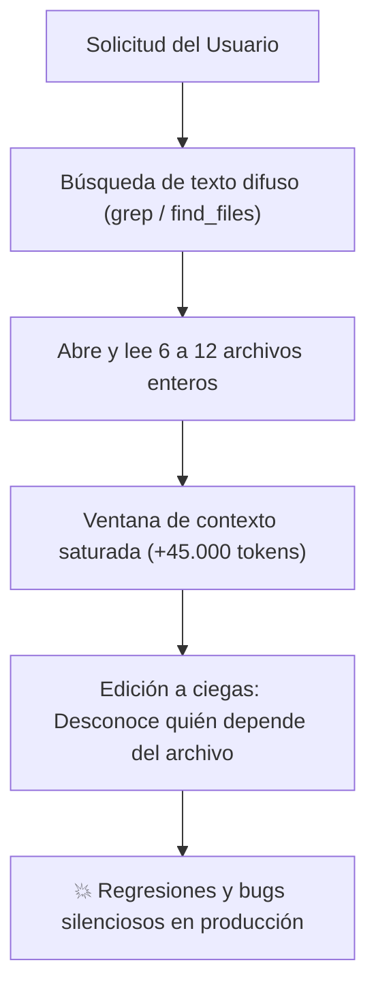
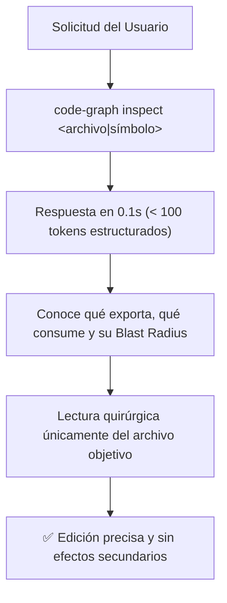

# ⚡ Code-Graph: El Antes y el Después en el Desarrollo con Agentes de IA

Este documento analiza en profundidad el impacto arquitectónico y operativo de incorporar **Code-Graph** en cualquier entorno de agentes autónomos de codificación (*Google Antigravity, Claude Code, Cursor, OpenCode, Codex, Cline, Roo Code, DeepSeek Harness*).

---

## 1. ¿Cómo trabajaba el agente ANTES? (La exploración a ciegas)

Cuando un desarrollador le pide a un agente convencional:

> *"Refactoriza el manejador de sesiones o ajusta el cliente de API para soportar reintentos exponenciales."*

Ocurre una secuencia ineficiente denominada **Exploración No Guiada**:



### El costo oculto de este proceso:
1. **Quema masiva de tokens:** Cada archivo mediano (*200 a 600 líneas*) consume entre **1.500 y 4.000 tokens**. Al leer varios módulos para rastrear imports, la sesión satura rápidamente entre **30.000 y 60.000 tokens de basura**.
2. **Latencia incrementada:** A mayor tamaño de la ventana de contexto, mayor es el tiempo de inferencia que toma el LLM en responder (Time-to-First-Token y tiempo de generación).
3. **Pérdida de foco cognitivo (*Context Drift*):** Los LLMs tienen límites de atención. Con la memoria llena de código irrelevante, la probabilidad de alucinaciones o de perder instrucciones clave aumenta drásticamente.
4. **Modificaciones con efecto dominó:** El agente edita un módulo sin saber qué otros componentes lo consumen, rompiendo contratos de interfaz en partes no visibles del repositorio.

---

## 2. ¿Cómo trabaja el agente AHORA con Code-Graph?

Con **Code-Graph**, el protocolo impone una regla estricta: **Prohibido explorar a ciegas**. Antes de abrir cualquier archivo, el agente consulta el motor de análisis estático en memoria:



### Ejecución práctica:
El agente ejecuta en terminal local:
```bash
node .agents/skills/code-graph/code-graph.mjs inspect sessionManager.ts
```

En **menos de 0.2 segundos** y consumiendo apenas **~80 tokens**, recibe la radiografía exacta:
```text
=== TARGET [42] src/lib/sessionManager.ts ===
EXPORTS: createSession, revokeSession, getSessionUser
DEPENDS_ON: 12(crypto.ts), 15(dbClient.ts)
#B d2: 8(sev:2.1), 19(sev:1.5), 33(sev:1)
IMPACTED_FILES:
  8 src/middleware/auth.ts (depth:1, sev:2.1)
  19 src/routes/user.ts (depth:1, sev:1.5)
  33 src/routes/billing.ts (depth:2, sev:1)
```

**Resultado:** El agente no tuvo que leer `crypto.ts`, `dbClient.ts`, `auth.ts`, ni `user.ts`. Sabe con precisión matemática qué funciones existen y exactamente qué módulos verificar tras su cambio.

---

## 3. Matriz Comparativa: Antes vs. Después

| Dimensión | Antes (Sin Code-Graph) | Ahora (Con Code-Graph) | Impacto Real |
| :--- | :--- | :--- | :--- |
| **Tiempo de localización de código** | 30 a 90 segundos (múltiples llamadas a herramientas) | **< 1 segundo** (`inspect` o `trace`) | **~98% más rápido** |
| **Consumo de Contexto (Tokens)** | 25.000 – 60.000 tokens en pura exploración | **200 – 1.200 tokens** estructurados | **75% a 90% de ahorro** |
| **Riesgo de Regresiones (Bugs colaterales)** | Elevado (no conoce el impacto fuera de su vista) | **Casi nulo** (el comando `blast` revela dependientes) | **Mayor estabilidad** |
| **Capacidad de razonamiento del LLM** | Degradada por saturación de contexto | **Máxima** (ventana de atención limpia y enfocada) | **Respuestas más inteligentes** |
| **Detección de Deuda Técnica** | Imposible sin herramientas externas pesadas | **Instantánea** (`health` reporta ciclos y god files) | **Arquitectura saludable** |

---

## 4. Transparencia Total: Lo que SÍ hace y lo que NO hace

Para mantener una expectativa rigurosa y técnica:

### ✅ Lo que SÍ hace:
- **Elimina el 90% de lecturas innecesarias:** Proporciona un mapa relacional sin costo de tokens pesados.
- **Predice el radio de explosión (*Blast Radius*):** Calcula el impacto topológico con severidad ponderada $1 + \log(1 + \text{in\_degree})$.
- **Detecta dependencias circulares y dead-code:** Identifica ciclos con el algoritmo de Tarjan SCC e islas de archivos no referenciados.
- **Acelera la respuesta del agente:** Al reducir la carga de tokens entrantes, la API del modelo responde en una fracción del tiempo.

### ❌ Lo que NO hace:
- **No sustituye la lectura del archivo que se va a editar:** El agente aún debe leer las líneas exactas del archivo que va a transformar para aplicar el `diff` o reemplazo con precisión de caracteres.
- **No inventa lógica de negocio:** Sigue siendo responsabilidad del desarrollador y del modelo diseñar la solución de código; Code-Graph garantiza que el modelo trabaje sobre el contexto correcto.

---

## 5. Conclusión

Incorporar **Code-Graph** transforma a los agentes de IA: dejan de comportarse como desarrolladores recién llegados que recorren carpetas adivinando dónde están las cosas, y pasan a trabajar como **arquitectos senior con memoria fotográfica del repositorio**.
